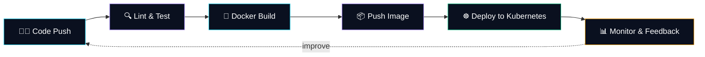

<!-- ============================================================= -->
<!--  HRITIK RANJAN • DEVOPS ENGINEER • GITHUB PROFILE README      -->
<!-- ============================================================= -->

<div align="center">


<a href="https://devops.hritikranjan.in/">
  
</a>

<br/><br/>

<a href="https://devops.hritikranjan.in/"></a>
<a href="https://blogs.hritikranjan.in/"></a>
<a href="https://linkedin.com/in/hritikranjan1"></a>
<a href="mailto:1hritikranjan@gmail.com"></a>

<br/><br/>


</div>

---

## 👨‍💻 whoami

```bash
$ whoami
hritik-ranjan

$ cat profile.yaml
role:        DevOps Engineer
company:     Staqu Technologies
location:    Gurugram, Haryana, India 🇮🇳
background:  QA Engineer -> DevOps (quality mindset baked into every pipeline)
focus:       [ "CI/CD", "Kubernetes", "AWS", "Docker", "Terraform", "Linux" ]
mission:     "Automate everything. Break nothing. Ship fast."
open_to:     DevOps / Cloud / Platform Engineering opportunities

$ echo $GOAL
Grow into a Senior DevOps / Cloud / Platform Engineer 🚀
```

I'm a **DevOps Engineer** who started in **QA and software testing**, and that background shapes how I work: every deployment should be repeatable, every pipeline should be tested, and every outage should teach something. I enjoy turning manual, error-prone work into **automated, observable and reliable systems**.

> 💡 **My edge:** I think like a tester and build like an engineer. That means fewer "works on my machine" surprises and more confident releases.

---

## 🎯 What I Do

<table>
<tr>
<td width="50%" valign="top">

### ⚙️ CI/CD & Automation
- Build pipelines with **GitHub Actions** and **Jenkins**
- Automate build, test and deploy workflows
- Shell scripting to remove repetitive toil

### 🐳 Containers & Orchestration
- Containerize apps with **Docker** and **Docker Compose**
- Deploy and run workloads on **Kubernetes**
- Work with **RKE2**, ingress, and reverse proxies like **Nginx**

</td>
<td width="50%" valign="top">

### ☁️ Cloud & Infrastructure
- Design **AWS** networks (Multi-AZ VPC, subnets, routing)
- Host and deploy static sites with **S3**
- Write Infrastructure as Code with **Terraform**

### 🐧 Systems & Operations
- Linux administration (**RHEL**, Ubuntu) and troubleshooting
- On-prem deployments and networking fundamentals
- Debugging real-world deployment issues end to end

</td>
</tr>
</table>

---

## 🛠️ Tech Arsenal

<div align="center">

### ☁️ Cloud & Infrastructure


### 🐳 Containers & Orchestration


### 🔄 CI/CD & Version Control


### 💻 Languages & Scripting


### 🗄️ Databases & Backend


### 🧪 Testing & Automation (my QA roots)


</div>

### 📊 Skill Snapshot

| Domain | Tools | Level |
|:--|:--|:--|
| 🔄 **CI/CD** | GitHub Actions, Jenkins | `████████░░` Strong |
| 🐳 **Containers** | Docker, Docker Compose | `████████░░` Strong |
| ☸️ **Orchestration** | Kubernetes, RKE2 | `███████░░░` Growing fast |
| ☁️ **Cloud** | AWS (VPC, EC2, S3, IAM) | `███████░░░` Growing fast |
| 🏗️ **IaC** | Terraform | `██████░░░░` Learning |
| 🐧 **Linux & Shell** | RHEL, Ubuntu, Bash | `████████░░` Strong |
| 🌐 **Networking** | TCP/IP, DNS, Nginx, Ingress | `███████░░░` Growing fast |
| 🧪 **Testing** | Selenium, Playwright, Postman | `█████████░` Expert (QA background) |

---

## 🚀 Featured DevOps Projects

<div align="center">

| 🏗️ Project | 📝 What It Does | 🧰 Stack |
|:--|:--|:--|
| **[AWS Multi-AZ VPC Blueprint](https://github.com/hritikranjan1?tab=repositories)** | Highly available AWS network design across multiple Availability Zones | `AWS` `VPC` `Networking` |
| **[DevOps Learning Tracker (Docker)](https://github.com/hritikranjan1/devops-learning-tracker)** | Full-stack tracker for DevOps learning, run with Docker Compose | `Flask` `MySQL` `Nginx` `Docker` |
| **[DevOps Learning Tracker (K8s)](https://github.com/hritikranjan1/devops-learning-tracker-k8s)** | Same app, deployed on Kubernetes manifests | `Kubernetes` `Flask` `MySQL` `Nginx` |
| **[SteganoVault (Docker)](https://github.com/hritikranjan1/SteganoVault-Docker)** | Hides messages inside images, text, PDF, DOCX, audio and video | `Flask` `MySQL` `Nginx` `Docker` |
| **[SteganoVault (K8s)](https://github.com/hritikranjan1/SteganoVault-k8s)** | Kubernetes deployment of SteganoVault | `Kubernetes` `Flask` `MySQL` |
| **[Static Portfolio CI/CD](https://github.com/hritikranjan1?tab=repositories)** | Push to GitHub, auto-deploy to AWS S3 | `GitHub Actions` `AWS S3` |

</div>

<div align="center">

<a href="https://github.com/hritikranjan1?tab=repositories"></a>

</div>

---

## 🔄 How I Think About Delivery



---

## 💼 Experience

| 🗓️ Period | 🏢 Company | 🎯 Role | 🔧 Focus |
|:--|:--|:--|:--|
| **Sept 2026 - Present** | **Staqu Technologies** | DevOps | Deployments, Kubernetes (RKE2), Docker, Linux, CI/CD |
| **Sept 2025 - Sept 2026** | **eSec Forte Technologies** | QA Engineer | Manual and automation testing, API testing, Playwright, Selenium |
| **Feb 2025 - Aug 2025** | **eSec Forte Technologies** | Information Security Intern | Cybersecurity fundamentals and security testing |

---

## 🌱 Currently Levelling Up

- ☸️ Production-grade **Kubernetes** (RKE2, Ingress, Calico networking)
- 🏗️ **Terraform** for repeatable cloud infrastructure
- ☁️ **AWS DevOps** services and architecture best practices
- 🔄 Advanced **CI/CD** pipelines (build, scan, deploy, rollback)
- 📊 Monitoring and observability mindset
- ✍️ Documenting every lesson on my **[blog](https://blogs.hritikranjan.in/)**

### 🗺️ My DevOps Roadmap

| Stage | Milestone | Status |
|:--|:--|:--:|
| 1 | Linux, Git, Shell scripting | ✅ |
| 2 | Docker and Docker Compose | ✅ |
| 3 | CI/CD with GitHub Actions and Jenkins | ✅ |
| 4 | AWS networking and static hosting | ✅ |
| 5 | Kubernetes in practice | 🔄 In progress |
| 6 | Terraform and Infrastructure as Code | 🔄 In progress |
| 7 | Monitoring, logging and observability | 🎯 Next |
| 8 | Platform Engineering and SRE practices | 🎯 Goal |

---

## 📊 GitHub Analytics

<div align="center">


<br/>


</div>

---

## 🐍 Contribution Snake

<div align="center">
<picture>
  <source media="(prefers-color-scheme: dark)" srcset="https://raw.githubusercontent.com/hritikranjan1/hritikranjan1/output/github-snake-dark.svg">
  <source media="(prefers-color-scheme: light)" srcset="https://raw.githubusercontent.com/hritikranjan1/hritikranjan1/output/github-snake.svg">
  
</picture>
</div>

---

## ✍️ Latest from My Blog

I write about my **DevOps and Cloud journey**: real problems, real fixes, no fluff.

<div align="center">

<a href="https://blogs.hritikranjan.in/"></a>

</div>

> 💬 *Optional:* add the auto-updating blog workflow described at the bottom of this file to show your latest posts here.

---

## 🏆 Principles I Work By

- 🔁 **Automate the boring stuff**: if I do it twice, I script it
- 🧪 **Test everything**: infrastructure deserves QA too
- 📖 **Document as I learn**: knowledge shared is knowledge multiplied
- 🛡️ **Security from day one**: shift left, not later
- 📈 **Small, frequent, safe releases** beat big-bang deployments

---

## 🤝 Let's Build Something Reliable

<div align="center">

I'm open to **DevOps, Cloud and Platform Engineering** conversations and collaborations.

<br/>

<a href="https://devops.hritikranjan.in/"></a>
&nbsp;
<a href="https://linkedin.com/in/hritikranjan1"></a>
&nbsp;
<a href="https://blogs.hritikranjan.in/"></a>
&nbsp;
<a href="mailto:1hritikranjan@gmail.com"></a>

<br/><br/>

**⚙️ Building • ☸️ Orchestrating • 🔄 Automating • 🚀 Shipping**


</div>

<!--
=====================================================================
OPTIONAL: AUTO-UPDATE LATEST BLOG POSTS (Hashnode)
1. In this profile repo create: .github/workflows/blog-post-workflow.yml
2. Add the workflow below, then place the START and END markers
   (BLOG-POST-LIST:START and BLOG-POST-LIST:END, written as HTML
   comments) in the blog section of this README.

name: Latest blog posts
on:
  schedule:
    - cron: '0 */12 * * *'
  workflow_dispatch:
jobs:
  update-readme:
    runs-on: ubuntu-latest
    steps:
      - uses: gautamkrishnar/blog-post-workflow@v1
        with:
          feed_list: "https://blogs.hritikranjan.in/rss.xml"
          max_post_count: 5
=====================================================================
-->
